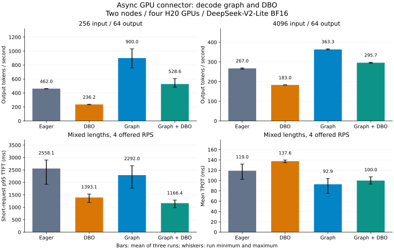

# Async GPU decode graph and DBO benchmark

On two nodes/four H20s, graph + DBO improves mean closed-loop output throughput
by **14.4% / 10.8%** versus both off at 256/4096 input tokens. At mixed 4 RPS,
short-request p95 TTFT falls from **2558 to 1166 ms**. Graph alone remains faster
for uniform throughput. Formal confirmation covers **11648 requests, zero
HTTP/stream/token-usage errors**, with three runs per arm.

This is a bounded interoperability/performance qualification. Long random
autoregressive probability parity versus full eager remains unqualified; the
failed diagnostic and old-policy control are retained below.

## Scope and implementation

`GpuAsyncAFDConnector` already supported native MRV2 two-stage DBO and decode
full-graph replay. The missing performance coverage was on FFN: with the
4096-token budget, top-k 6 and two FFN ranks, its default smallest graph held
3072 routed rows. Decode and short prefills usually fell back to eager execution.

The default FFN ladder now also captures powers of two through 1024 rows. Small
work accepts at most 2x padding; larger work retains the existing 1.05x guard.
The smallest bucket must fit both routed and shared-expert rows. Explicit
`AFD_FFN_GRAPH_FRACTIONS` calibration retains its requested ladder. Workspace
reservation, graph memory reserve, eager fallback and transport are unchanged.

Attention retains MLA and `FULL_DECODE_ONLY`. **Decode** uses the native full
CUDA Graph, including graphs containing both DBO microbatches. Attention prefill
remains eager. Local FFN expert graphs can serve both prefill and decode; they
do not turn Attention prefill into full-graph execution.

## Fixed comparison

All four arms use the same source snapshot, weights, allocated GPUs, token
budgets and serving controls. Compare full eager, DBO alone, graph alone, and
both features together. These measurements compare async execution settings;
the earlier [sync connector comparison](async_gpu_prefill_benchmark.md) remains
a separate experiment.

- Slurm job 16795; H20 nodes `vllm-sgp-h20-03` and `vllm-sgp-h20-04`, two GPUs
  per node. Attention DP2/TP1 on the first; FFN EP2/TP1 on the second.
- DeepSeek-V2-Lite-Chat BF16 snapshot
  `85864749cd611b4353ce1decdb286193298f64c7`, seed 0; model length 32768,
  batch token budget 4096, max sequences 32, GPU memory utilization 0.5.
- Chunked prefill on, prefix caching off, Attention-side routing,
  `GpuAsyncAFDConnector`, NVSHMEM IBRC. No profiler, worker extension or
  per-layer diagnostic logging during measurement.
- Torch 2.13.0+cu130, vLLM 0.32.0 pinned to
  `5df63a7203cdb9328d824a27b682e77c7b9928be`, NCCL runtime 2.30.7,
  NVSHMEM 3.4.5. Normal installation, without `LD_PRELOAD`.
- Graph arms: compilation mode 0, `FULL_DECODE_ONLY`, Attention capture sizes
  1, 2, 4, 8, 16, 32. Eager arms set `--enforce-eager` on both roles.
- DBO arms: `--enable-dbo --dbo-decode-token-threshold 2
  --dbo-prefill-token-threshold 512` on both roles; exactly two native ubatches.
  Decode threshold 2 exercises two stages at small decode batches; the prefill
  threshold retains the pinned vLLM default, avoiding two-stage overhead for
  small mixed prefill/decode steps.
- Fresh servers for each arm and round. Three seeds, with arm order rotated:
  eager/DBO/graph/both, both/graph/eager/DBO, graph/both/DBO/eager.

## Workloads and metrics

Closed-loop tests use pinned `vllm bench serve`, 128 requests, concurrency 32,
four warmups, fixed input lengths 256 and 4096, and 64 output tokens with EOS
ignored. Report output-token throughput, TTFT, TPOT and end-to-end latency.
These tests use the native API load balancer.
Sampler JIT warnings occur in some graph-arm logs and remain included in
timing; four warmups do not establish that every sampling shape is warm. No
requests or latency spikes are filtered from the reported results.

Open-loop tests use [`prefill_skew.py`](../../tools/benchmarks/prefill_skew.py):
80% 256-token and 20% 16384-token prompts, seeded Poisson arrivals. `mixed`
alternates DP destinations; `token_balanced` uses a fixed greedy input-token
assignment. The latter is a control for imbalance, not a dynamic scheduler.
Use 64 output tokens at 1 and 4 RPS, each for 60 seconds. A single-output-token
prefill control runs at 2 RPS for 30 seconds. Arrival, prompt and destination
plans must match across all four arms within each round. Drain time is included
in achieved throughput; errors and token-usage mismatches fail the run.

Open-loop TPOT is the time from the first token to stream completion divided
by the remaining output-token count. It includes final stream/usage delivery.
A fixed offered rate can remain below capacity in every arm, so lower latency
at that rate is not itself a capacity increase.

## Correctness and execution evidence

The initial four-arm qualification uses aggressive DBO thresholds 2/12. The
existing native DP2/EP2 reference and numerical bound are retained: 819
teacher-forced prompt positions, maximum reference-token log-probability delta
at most 0.5, and no argmax change where the reference top-two margin exceeds
0.5. All four arms pass; 754 confident positions agree. The final 2/512 combined
configuration also passes this prompt check (maximum delta 0.4574).

A separate instrumented workload generates 64 tokens for each of 12 concurrent
requests. At thresholds 2/512, both Attention ranks execute 63 full-graph replays
whose descriptors contain two ubatches. FFN ranks replay 6324 and 6424 local
graphs, consuming both source ranks and stage IDs. This establishes simultaneous
execution, not merely accepted flags. Diagnostic workers are absent from timing.

A device-side local-expert reference check snapshots each input before graph
execution and computes the same work eagerly. Each FFN rank checks 2048 actual
graph work items: routed and shared finite outputs are identical, with matching
nonfinite positions. Some transmitted padding rows are already NaN in the
shared input; identical NaNs are compared as such. The first diagnostic's default
NaN inequality produced a false failure; its tensor snapshot and failed log are
retained. The corrected check preserves the existing GPU test's 2e-2 relative
and absolute limits and observes zero finite error.

### Autoregressive numerical limit

Do not interpret these checks as an eager-equivalent probability distribution
for arbitrary long free generation. In the 2/512 combined run, a separate
random-token 12x64 decode comparison exceeds the 0.5 reference-token bound:
maximum delta 2.3127 over 579 positions through each first divergence. All 550
confident argmax positions agree. Four requests first diverge at low-margin
positions. This diagnostic remains **failed** in the manifest.

Disabling the new small buckets while retaining Attention graph + DBO reproduces
the same four first-divergence positions and a maximum delta of 2.3716. Comparing
the new and old FFN graph policies directly passes the unchanged reference-token
bound (maximum delta 0.2616 over 709 positions; all 676 confident choices agree).
Repeating full eager yields a maximum delta of 0.3509 against its earlier run.
Together with the exact local FFN outputs, this rules out a new small-bucket
calculation error in these cases. It does not isolate the precise cause in the
existing combined Attention/backend path or establish a full accuracy result.

The initial 2/12 decode comparison passes its reference-token bound at 0.3441,
but an exploratory comparison over all common top-five alternatives exceeds
0.5 (maximum 2.4283). Both results are retained. No tolerance is increased to
turn any failed diagnostic into a pass, and full-distribution or bitwise
free-generation agreement is not claimed.

## Prefill threshold calibration

A one-round four-arm stress comparison uses decode/prefill thresholds 2/12:
3832 requests, zero HTTP/stream/token-usage errors. Its complete
[32-point CSV](data/async_gpu_dbo_graph_stress12_20261122.csv) is retained.
In rolling 256-input/64-output closed-loop work, both features achieve 459.89
output tok/s versus 451.81 with both off. At mixed 4 RPS, they reduce short p95
TTFT from 2825.9 to 1191.9 ms, but the extra two-stage work limits closed-loop
throughput.

A separate 128-request calibration at the native prefill threshold 512 raises
combined short-input throughput to 577.40 output tok/s (mean TPOT 51.04 ms).
Decode DBO remains enabled at threshold 2. The formal three-round confirmation
uses this fixed 2/512 configuration for both DBO arms; the stress data and
calibration run are excluded from its summaries. This is a calibration followed
by confirmation, not a claim that threshold 512 is optimal for other workloads.

## Formal results

All values below are arithmetic means of three runs. Each CSV row is one run;
the plot shows the run minimum and maximum, not a confidence interval.



### Closed-loop throughput and decode latency

| Mode | 256 input: output tok/s | 256 input: TPOT ms | 4096 input: output tok/s | 4096 input: TPOT ms |
| --- | ---: | ---: | ---: | ---: |
| Both off | 462.03 | 64.66 | 266.97 | 98.22 |
| DBO only | 236.21 | 131.07 | 182.97 | 152.17 |
| Graph only | 900.04 | 31.71 | 363.28 | 67.56 |
| Graph + DBO | 528.55 | 57.00 | 295.74 | 86.34 |

### Mixed-length decode

64 output tokens; achieved throughput includes drain. Short p95 is computed
within each run before averaging, rather than pooling requests across seeds.

| Profile | Offered RPS | Mode | Achieved RPS | Short p95 TTFT ms | Mean TPOT ms | Mean E2E s |
| --- | ---: | --- | ---: | ---: | ---: | ---: |
| mixed | 1.0 | Both off | 0.919 | 291.8 | 67.58 | 4.700 |
| mixed | 1.0 | DBO only | 0.877 | 367.8 | 125.96 | 8.413 |
| mixed | 1.0 | Graph only | 0.947 | 160.2 | 24.93 | 1.906 |
| mixed | 1.0 | Graph + DBO | 0.949 | 188.3 | 35.82 | 2.533 |
| mixed | 4.0 | Both off | 3.724 | 2558.1 | 118.97 | 8.538 |
| mixed | 4.0 | DBO only | 3.517 | 1393.1 | 137.60 | 9.376 |
| mixed | 4.0 | Graph only | 3.840 | 2292.0 | 92.87 | 6.790 |
| mixed | 4.0 | Graph + DBO | 3.768 | 1166.4 | 99.97 | 6.894 |
| token_balanced | 1.0 | Both off | 0.922 | 219.6 | 62.75 | 4.340 |
| token_balanced | 1.0 | DBO only | 0.885 | 353.1 | 114.70 | 7.651 |
| token_balanced | 1.0 | Graph only | 0.947 | 130.4 | 26.08 | 1.953 |
| token_balanced | 1.0 | Graph + DBO | 0.949 | 147.7 | 32.26 | 2.285 |
| token_balanced | 4.0 | Both off | 3.731 | 1045.7 | 123.39 | 8.426 |
| token_balanced | 4.0 | DBO only | 3.528 | 733.5 | 141.53 | 9.458 |
| token_balanced | 4.0 | Graph only | 3.832 | 987.8 | 97.34 | 6.732 |
| token_balanced | 4.0 | Graph + DBO | 3.769 | 661.0 | 101.29 | 6.847 |

### Prefill-only control

One output token, 2 offered RPS. This workload does not measure Attention
decode graph gains; local FFN graphs and DBO can still change prefill latency.

| Profile | Mode | Mean TTFT ms | Short p95 TTFT ms | Achieved RPS |
| --- | --- | ---: | ---: | ---: |
| mixed | Both off | 397.6 | 712.6 | 1.931 |
| mixed | DBO only | 275.1 | 362.3 | 1.953 |
| mixed | Graph only | 388.5 | 690.2 | 1.931 |
| mixed | Graph + DBO | 267.7 | 353.0 | 1.953 |
| token_balanced | Both off | 319.9 | 116.7 | 1.930 |
| token_balanced | DBO only | 243.9 | 109.2 | 1.953 |
| token_balanced | Graph only | 309.3 | 97.9 | 1.931 |
| token_balanced | Graph + DBO | 236.4 | 105.3 | 1.953 |

### Paired comparisons

Graph + DBO relative to both off, with the same seed in each pair:

- 256-token input: per-run throughput gains +4.5%, +6.8%, +32.1%.
- 4096-token input: per-run throughput gains +9.6%, +11.6%, +11.1%.

### Interpretation

Graph alone has the highest mean closed-loop throughput at both input lengths.
Both features together improve throughput versus both off in every paired run,
but short-input gains vary substantially (+4.5% to +32.1%). The separate
577.40 tok/s calibration is excluded; the formal short-input mean is 528.55.

For mixed 4 RPS, the combined configuration reduces short p95 TTFT by 54.4%,
mean TPOT by 16.0%, and mean E2E latency from 8.538 to 6.894 seconds versus both
off. Graph alone has better mean TPOT/E2E and achieved throughput, while both
features have much lower short-request p95. In the single-token mixed control,
both reduce short p95 from 712.6 to 353.0 ms; Attention prefill is still eager.
Choose according to the workload's latency/throughput target. These results do
not establish that enabling DBO always improves graph-only execution or that
this connector now outperforms the synchronous connectors in the earlier study.

## Reproduction and artifacts

The [CSV](data/async_gpu_dbo_graph_20261122.csv) contains every formal run and
workload point. The [manifest](data/async_gpu_dbo_graph_20261122.json) contains
source hashes, exact role/client commands, runtime versions, correctness
results and cleanup status. Raw logs and responses are retained under
`.venv/validation-async-dbo-graph/` on the shared cluster filesystem. Pilot runs
are excluded from formal summaries.

For one open-loop arm, allocate two GPUs on each of two nodes and run:

```bash
.venv/bin/python tools/benchmarks/run_prefill_skew_slurm.py async \
  --job-id "$JOB_ID" --attention-host "$ATTENTION_NODE" \
  --ffn-host "$FFN_NODE" --model "$MODEL" --output "$RESULT_DIR" \
  --dbo -- --profiles mixed token_balanced --rates 1 4 \
  --duration 60 --repeats 1 --seed 20261122 --output-tokens 64
```

The command above selects both features. Drop `--dbo` for graph alone; add
`--eager` for DBO alone; use `--eager` without `--dbo` for both off. Use seeds
20261122, 20361122 and 20461122 for the three formal rounds. Exact closed-loop
commands, including warmups and random-dataset parameters, are in the manifest.
